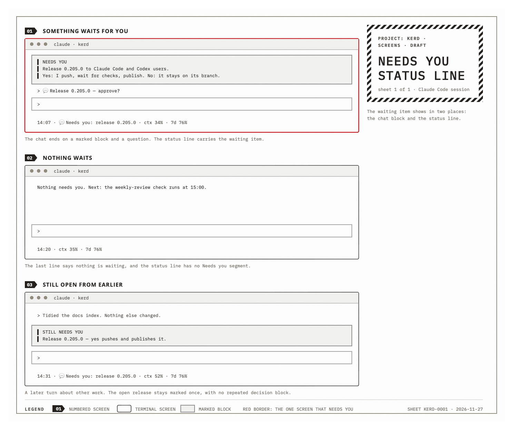

# Seeing when a session needs you

**Decision:** Build the "Needs you" status line and marked turn endings, and replace the ask-once rule with "restate in one line"?
**Recommendation:** Option A: a "💬 Needs you" segment in the status line, a marked block when a turn needs you, and every open question restated in one line with what yes does.  ·  **Cost:** $0  ·  **Time:** about one sitting to build; saves hunting through scrollback
**Owner:** Kerd session  ·  **Status:** draft  ·  **Updated:** 2026-11-27 11:4x

## In short

- You can't see in a session when it needs you: the ask scrolls away, and later turns only say "asked at 15:11".
- With A, the line under your input box names what waits for you in every Kerd session; a turn that needs you ends in a marked block saying what yes does; any later mention restates the question itself.
- We lose nothing you use. The only trade: the full question block is shown once, and later turns repeat one line, not the whole block.

Screens (source): `docs/design/needs-you-screens.html`. The figures in them (times, percentages, "release 0.205.0", the docs-index line in screen 3) are examples, not real state.

## Options

| Option | What it is | Cost | Gain | What we lose |
|---|---|---|---|---|
| **A (recommended)** | Status-line segment + marked turn ending + "restate in one line, never the whole block again" in place of ask-once | $0 | You always see what waits, in the session itself | Nothing visible; the long block shows once |
| B | Same, but remove ask-once outright: every turn while a question is open ends on the full question again | $0 | Same visibility | The same bubble on every check and wake-up, which is what ask-once was added to stop ("distill, don't repeat") |
| C | Put "Needs you" in Kerd's overtone band instead of the status line | $0 | No change to the status line | The band is above the chat area, easier to miss; Codex sessions get neither |
| Do nothing | Questions live in the chat; later turns say "asked 15:11" | $0 | — | You keep searching scrollback for what needs you |

**A, the ask-once part, explained here:** your ask is "remove ask once". A does remove its "asked 10:20" form and its rule that the question is not stated again. What it keeps is one thing: a later turn restates the open question in one line ("Release 0.205.0 — yes pushes and publishes it"), not the whole decision block and bubble. B removes that too. The rule was added on 2026-11-21 because a recurring check put the same full bubble on screen every few minutes; B brings that back. Your call.

## What happens on yes

1. Kerd session builds on its own branch: a status-line segment (Kerd's existing `hooks/statusline.sh` already wraps another status line, so scorched-earth's figures stay), fed from the project's `### Asks` table and a small per-project file the session writes when it asks you and clears when you answer.
2. Conductor, Switch and Agent: a turn that needs you ends in a marked `NEEDS YOU` block (what's needed, what yes does, then the question); other turns end "Nothing needs you" with what happens next; the ask-once rule becomes "restate in one line".
3. Fresh Codex review, tests, then back to you for the release.
4. On your go, the release, and one change to your status-line setting so Kerd's segment wraps scorched-earth's (this machine only).

## Needs his hands

- Nothing beyond the go. The status-line setting change is made by Kerd on your yes.

## Detail

- **Where the line lives.** The live status line here is scorched-earth's wrapper (`~/.claude/settings.json` → `statusLine`). Kerd's `hooks/statusline.sh` is built to wrap an existing status line ("an occupied statusLine slot keeps working"), so the setting becomes Kerd's script with scorched-earth's command as its argument. Claude Code only; Codex has no status line, so Codex sessions get the marked endings only.
- **What feeds it.** (1) The `### Asks` table in `TODO.md` `## Now` (kept by `cos.py ask` while the chief of staff is on). (2) A per-project `.git/kerd/needs-you` file for the session's own pending question, written when a turn ends on a question and cleared when it is answered, so projects without a chief of staff work too. Blank when both are empty. The status line reads the session's working folder from Claude Code's status JSON.
- **Format.** `💬 Needs you: <short label> · <second>`; more than two shows `+N`. Labels come from the Asks table's question, cut to a few words.
- **Turn endings.** Needs you: the marked block, then the bubble. Nothing: one line, "Nothing needs you", plus what runs next. A later turn with the question still open: `STILL NEEDS YOU` plus the one-line restatement, no second bubble.
- **What changes in Kerd's rules:** journey.md "Ask once" (§ at line 267) rewritten as "Restate, don't repeat"; the "Asking once" paragraph in the Conductor, Switch and Agent SKILL.md files; the test `skills/conductor/scripts/tests/test_ask_once_wording.py`.
- **Source:** your words relayed by cosplay-fb, 2026-11-27 11:27–11:30: "finding it hard to see when i need to approve something or answer a question on the sessions … i mean in the actual sessions"; "you often say something is waiting for me as told at 15:11 … why not tell me there vs me trying to find it"; "tell kerd to remove ask once rule - seems redundant".
