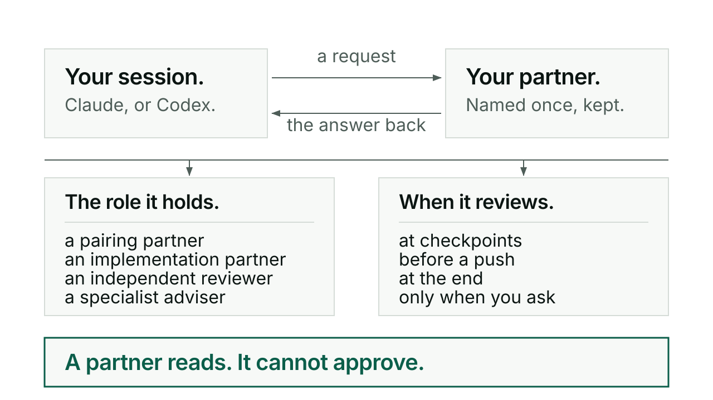

# Agent

Agent gets a contribution from another AI session and brings its answer back:
Claude asking Codex, Codex asking Claude, or either one asking a session that
already has the context you need. It keeps track of which session is which, so
"ask Codex to recheck this" reaches the partner you paired with rather than a
stranger who has never seen the work. Reviews are the exception: they go to a
fresh reviewer by default, unless you name the partner.

## When you would reach for it

When you want a second opinion on something before it ships, from a model that
has not spent the last hour convincing itself. When the session that holds the
history of a piece of work is not the session you are typing into. When you want
a standing arrangement: a partner with a role for multi-turn work, and a
recorded review cadence that sets when reviews happen without asking each time
(the reviewer is still a fresh one unless you choose that partner). And when a job is bounded enough to hand to a
fresh worker that needs no context at all.

It can show your partner a picture, too: a screenshot, a mockup, a diagram. Say
"show Codex this" and Agent sends the file's location, and your partner opens it
with its own viewer. Codex's message route cannot carry the picture itself, so it
is sent by where the file is, never attached. Tested with a Codex partner; not yet
with a Claude one.

## How it goes

You ask in words:

```text
/kerd:agent help
/kerd:agent show sessions
/kerd:agent ask Claude to review, RO
/kerd:agent start a Codex pairing partner
/kerd:agent anything back from Codex?
```

Those are conversational examples rather than fixed subcommands. `/kerd:agent
help` shows a short list first and expands only the part you asked about.

If a partner is already established for this project, that partner is used,
except for reviews, which go to a fresh reviewer unless you name the partner. No
question, no picking from a list again. If none is established, or which session
you mean is genuinely unclear, you get the sessions that match, led by provider,
whether each is an established partner, its alias and a short ID. The saved native
title comes second, labelled as possibly old, because a session's title describes
what it was doing when it was named and not what it is doing now. Only a session
whose ID matches the host's exactly is marked as this one.

Then a deliberate choice between three things: the existing partner, a new
ongoing partner, or a fresh bounded worker. One is never silently swapped for
another, because an independent read by a fresh worker and a conversation with a
partner who knows the work are different jobs.

Which route Kerd uses depends on the work. A review (a checkpoint, before a
push, a pull request) goes to a fresh, record-briefed reviewer from the other
provider that Kerd starts through Agent, read only: a Codex reviewer when Claude
builds, a Claude reviewer when Codex builds. If the other provider can't start,
Kerd uses a different model of the same provider, as its own native subagent,
and tells you so. Its brief
names the records to read (the work's notes, the decisions, the diff), and its
verdict is written back to the notes. A standing Codex partner is for multi-turn
Codex work, or when you ask for one. Your own `codex` window is used only while
you are at it. A review you send to a named partner goes to that partner. The
reason: a Codex window takes a queued request only when it takes its next turn,
so one left unattended holds a review until someone types in it.

Multi-turn Codex work uses a Codex partner Kerd starts for it, where Agent can
start one and its first ask is delivered. When the start or the delivery fails,
Kerd uses a fresh Codex worker for each turn, briefed from the records, and
tells you so. Since 0.193.1 a Codex partner Kerd starts can be asked again on
current Codex: Agent follows the daemon's linked control socket one step, only
to your own socket in a folder you own. Tried live once on one Mac: a read-only
partner answered its first ask in 5 seconds, and again after 21 minutes idle in
4 seconds. One idle gap is not proof the route never stalls.

`partners` shows when each pairing last sent a request and last replied. It
marks a pairing stale when it has not replied in 14 days (or never has, and the binding is older than 14
days), or when a request sent
since its last reply has gone unconfirmed for over a day. A stale partner is not
offered as reviewer by default; if you name it, you are told it is stale and a
fresh reviewer is recommended. Switch In no longer greets stale pairings: it
lists them as one line for you. Retiring one moves its binding aside, never
deleting it, and happens only when you say yes. Moving the file back restores
the pairing. A partner that answers you some other way, say in its own window,
can look stale to Kerd, which is why retiring is only offered.

A Codex that Kerd starts, fresh worker or new partner, runs with native approval
prompts disabled, and its shell commands can't reach the network by default:
read-only for a review, edits inside the project for an editing job. It can't
install packages or run tests that need downloads. Codex's own web search is
separate and follows your Codex configuration.
Kerd says so when it offers those routes. For a Codex whose commands can reach
the network, open `codex` in a new terminal in the project folder and ask Kerd to
use it: Kerd finds the session itself, with no ID to copy, and your own settings
apply. Setting `[sandbox_workspace_write] network_access = true` in
`~/.codex/config.toml` lets Kerd's own editing jobs' commands reach the network; a
review's commands never do, and a managed Codex Roll refuses to run whenever the
setting gives it effective network access.

When you set up an ongoing partner, you are asked once for two things and then
never again: the role that partner holds, in your own words, and the review
cadence recorded with it, which sets when reviews happen.
Four role shortcuts are offered, pairing partner, implementation partner,
independent reviewer, specialist adviser, and any responsibility you name instead
is recorded as you said it. The review cadence has four values: `checkpoints`,
`before-push`, `end`, and `on-request`, which stands alone. You can pick several
of the first three. [Conductor](conductor.md) reads that cadence to plan when
reviews happen; the reviewer is still a fresh one unless you chose that partner.

Underneath, the job is prepared with the relevant source paths, the outcome, the
contribution wanted, the checks, the authority and the stopping point. Before it
goes out you see the partner, the model, the job and the edit boundary. After it
goes out, queued, unconfirmed, running and returned stay distinct, and useful work
continues while the answer is outstanding. Kerd owns the retrieval through to a
complete reply or a stated blocker, because dispatching is not the same as
getting an answer. What comes back is read and assessed, and the useful findings
are recorded beside the work. Private session IDs and raw transport records stay
local.

Sessions are reached through what already exists: native Claude sessions, the
native Codex server, and a Codex terminal or Codex app thread you have open,
which is queued to exactly as it stands. Both providers use the CLI sign-in you already have. There
is no relay to copy and paste through, no Kerd inbox, no watcher and no service.

## A short exchange

When a pairing is missing its review cadence, the options are listed with their
meanings and the question comes last, in a speech bubble, the same form every
Kerd question takes. This is the shape, not a transcript:

```markdown
When reviews happen on this work, recorded with the Codex pairing, one or more of:
- checkpoints
- before-push
- end, at the end
- on-request, only when you ask, and on its own

> 💬 **Which review cadence should this Codex pairing record?**
```

Answer in words, or use the picker where your host has one. The picker carries
the same options and never closes off a free-form answer.

## What it will not do

A review request is not permission to edit or publish anything. New partners
start read only, and file edits need the agreed scope and an explicit write
flag.

A peer cannot approve an action waiting on you, and cannot route around a
refusal. The recorded cadence schedules a review inside work that is already
authorized; it grants no work, no contact beyond that, and no commit, push or
release. Those stay yours.

It will not substitute a fresh reviewer for the partner you named. If your
established partner is unavailable, you are told before alternatives are offered.
If it leaves a review unanswered for ten minutes, Kerd tells you and recommends a
fresh one-off reviewer, which starts only if you say yes; the push waits for it, and
your partner's request stays queued. Skipping the review is your call; Kerd never
recommends it.

It will not kill an occupied terminal, resume "latest", fork a session without
saying so, or wake an offline session to make a delivery look successful. Your
own Codex terminal or app thread is never resumed, forked or stopped; it is
queued to. Kerd
reads that queue without changing its messages. When it can read it, it says
whether a request is still waiting there, and for how long when that is known;
otherwise it says unknown. Switch In flags an established Codex partner whose
requests have waited over ten minutes.
A request that has left the queue may still be unanswered, and whether anyone is
attending the terminal is unknown until it answers.

An empty session list does not prove there is nothing there, and a returned
review is not a passed outcome. Both are reported as what they are.

## For the curious

Roles and session IDs live in private pairing metadata inside the Git worktree,
not in a tracked roster, and neither a role nor an alias grants a permission.
The metadata is local to that worktree; Git does not carry it to another machine.

After a `/clear` or a restart, Agent checks the host's actual session ID rather
than assuming the terminal's lifetime tells it anything. A role designation saved
by the previous session, or your explicit choice of a replacement, lets the
successor take over that binding. Claude can also recover the same role after a
later loss when the saved account and machine match and its predecessor is no
longer listed. That recovers routing, not unsaved work. Codex recovery after a
new ID is not supported.

The Claude launcher currently gives a new partner file tools, not a shell or the
ability to delegate further, so a contribution that needs those has to go another
way. New Claude partners also accept cross-session messages for that session's
lifetime, which is disclosed when the partner is created; other local senders can
then submit under that session's tool permissions.

There is no notification service that wakes a finished turn, so nothing follows
up unattended.

Every command in one line each: [reference](reference.md).


