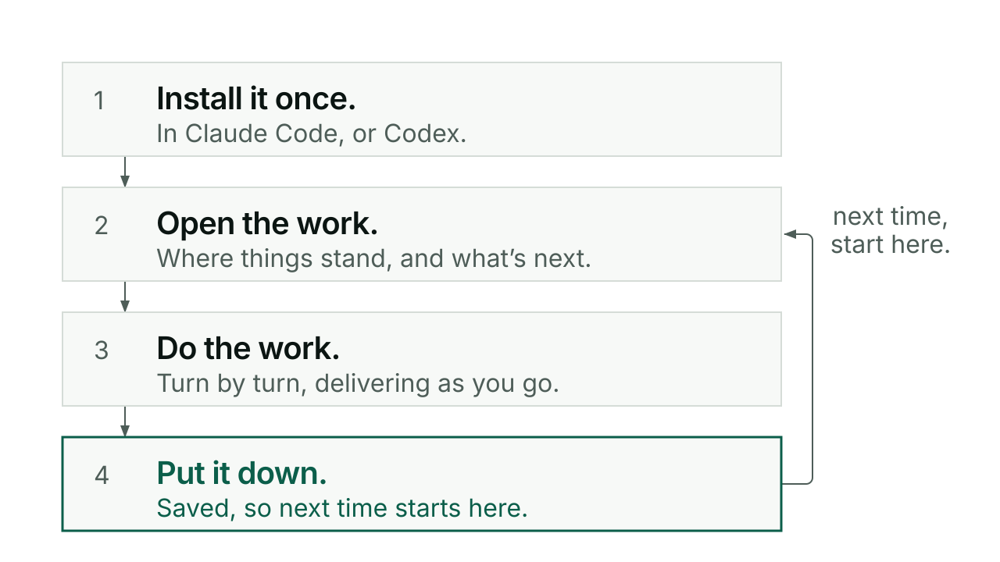

# Getting started

Kerd is a plugin. It does not run on its own: you use it inside Claude Code (or
Codex, which is early), in a project folder that git is tracking. What it
remembers about your work it writes as ordinary files in that folder, which is
why the next sitting can pick the work up, on this machine or another one. A
**sitting** is one stretch of work, from picking it up to putting it down.
Kerd's whole job is to make the next sitting start where the last one stopped.

There are eight skills. You do not have to learn them. To start you need two:
**switch** (picks your place up and puts it down) and **conductor** (helps you
work out what you want and build it). Tend is an optional tidy-up, covered near
the end of the first steps.

This page goes from nothing to a first saved sitting. It continues from the
README's [Your first five minutes](../../README.md#your-first-five-minutes),
which is the same journey in one paragraph. Before you rely on Kerd for
something that matters, read [Known limits](known-limits.md): it says what has
not been seen in real use yet.

## What you need first

- **Claude Code.** (Codex is possible but early; see [Codex (early)](#codex-early).)
- **git and Python 3.10 or newer, on macOS or Linux.** Kerd's save and pickup are
  git operations, and its helper scripts are Python. Check with `git --version`
  and `python3 --version`.
- **A project folder that git is tracking.** If your work is not in git yet, the
  next section shows how to start; the steps are listed there and need no account.

You do not need CI, custom hooks, or any wiring inside your own project. Kerd's
own hooks come from the plugin and load themselves when the plugin is enabled.

## If your work isn't in Git yet

Git is the tool Kerd uses to save your place. If your project is a folder of
documents, a spreadsheet export or a half-built app that has never been put under
git, set it up once:

1. Open a terminal in the project folder.
2. Run `git init`. This makes the folder a git repository. Nothing leaves your
   computer.
3. Look at what git would save: run `git status --untracked-files=all`. It lists
   each new file on its own line (plain `git status` folds a whole new folder into
   one line), and in a project already under git any tracked file that has changed.
   Files you have told git to ignore are not shown. Anything
   you do not want saved (passwords, API keys, a `.env` file, very large files, or
   files a program generates and you can rebuild) should be left out. To leave a
   file out, put its name on its own line in a new file called `.gitignore` in the
   project folder (for example `.env` or `output/`), then run the same command
   again to check it is gone from the list.
4. Run `git add .`, then `git diff --cached --name-only`. That prints the files
   that are about to be saved; check there is nothing in it you meant to leave out.
   Before the first commit, tell git who you are, once, so the save carries your
   name: run `git config --global user.name "Your Name"` and
   `git config --global user.email "you@example.com"` (use your own name and
   email; they stay on this computer unless you later push). Some machines, macOS
   among them, will otherwise save under a name git guesses from your computer and
   print a long warning. If that already happened, fix the save you just made with
   `git commit --amend --reset-author --no-edit` after setting the two lines above.
   Then run `git commit -m "First save"`. This records those files as the first
   saved version. If it says there is nothing
   to commit, the folder is empty or every file is ignored: add the files you want
   saved, then repeat this step.

That is enough. You do not need GitHub or any other online copy (Git calls one a
*remote*): a save that stays on this computer is a valid way to use Kerd, and
nothing in the first sitting needs one. Add one later if you want a backup or a
second machine. One thing to know: without one, Git keeps your saved work only on
this computer. An online copy holds a backup once your work has been sent to it
(*pushed*), so add one and send your work there, or arrange a backup another way,
if you need one. Kerd's closing box says when a save is on this computer only.

## Install in Claude Code

Type these two commands in a terminal, not inside a Claude Code session.
`claude plugin …` is a command for the terminal; a session does not run it.

```
claude plugin marketplace add anthonymaley/Kerd#plugin
claude plugin install kerd@kerd-marketplace
```

If the first command prints "SSH clone failed, retrying with HTTPS", that is
normal when you have no GitHub key set up. It retries and succeeds; you do not
need to do anything.

The `#plugin` part fetches only the small `plugin` branch (about 7 MB written in all, where the whole repository was about 63 MB), not the whole repository. If you installed Kerd before, it keeps working with no change; you do not need to re-add anything.

To try a version without adopting it, point Claude Code at a local checkout for
one session:

```
claude --plugin-dir /absolute/path/to/kerd
```

The local copy loads alongside whatever you already have, as a session-only
plugin: `claude plugin list` shows both, the installed one still enabled and the
local one loaded beside it. Close the session and that ends. Nothing is
installed and nothing is disabled, but it is not trace-free: starting a session
this way records one line of usage in your `~/.claude.json`. Tested in a
throwaway profile on 2026-09-20; which copy's skill text a running session
prefers has not been tested. The README's
[Install](../../README.md#install) section is the source for all three of these.

### Check that it worked

Do this before anything else. A session starting is not evidence that the
install took.

```
claude plugin list
```

Find Kerd in the list. The entry reads like this (your version number will be the
current release, not the one shown):

```
  ❯ kerd@kerd-marketplace
    Version: x.y.z
    Scope: user
    Status: ✔ enabled
```

Three things to read there: the name `kerd@kerd-marketplace`, the version you
meant to install, and a status of enabled. If Kerd is not in the list at all,
the install did not finish and nothing further on this page will work. If it is
listed but not enabled, the skills will not load either.

## First steps in a project

Do these in order. Everything here is what an ordinary day looks like.

1. Install Kerd (above).
2. Confirm it is there with `claude plugin list`.
3. In your project folder, run `/kerd:switch in` to open the sitting.
4. Do the work, with Conductor: say what you want in your own words.
5. Run `/kerd:switch out` to put it down.

That is the whole path. The first `/kerd:switch in` in a project that has never
used Kerd has nothing to restore, and it says so rather than manufacturing work
for you. Tell it what you want to work on and carry on. The first `/kerd:switch out`
tries to create what Kerd needs to remember the work: the session log and
`TODO.md`, if they are missing, alongside `CONTEXT.md` and the record of the work.
If it could not create one, its closing box says so.

### Optional: tidy the project with tend

```
/kerd:tend
```

You do not need this to start. Tend is for a project that wants Kerd's folders and
files set up. It gives one of two reports, depending on the project:

- **A project not yet set up for Kerd** (this is what a first-time project gets)
  gets a plain-words report: what tend would add or change and why, such as the
  `kivna/` and `kivna/sessions/` folders and a few `.gitignore` lines. Files that
  are optional, such as `CLAUDE.md` or `docs/playbook.md`, are listed as optional
  and are not marked as failing.
- **A project already set up** (it has a `kivna/vault.json`, a `docs/playbook.md`
  or anything in `kivna/` other than `sessions/` and `.gitkeep`) gets the drift report: nine categories (directories,
  required files, vault integration, deprecated patterns, naming, stray and stale
  files, `.gitignore`, skill hygiene, hook hygiene), each passing, warning or
  failing, with a current-versus-proposed table and a reason for anything that is
  not passing. A failing line there is a gap against Kerd's layout, not a sign
  that something is wrong with your project.

Either way it then asks for your approval. On a project not yet set up, that is
one plain question after a short list of what would be added, and nothing is
committed. On a project already set up, it is the drift report's question, for
example:

> 💬 **Fix all three findings — approve?**

Tend changes only what its report lists, and only after you approve. The
not-yet-set-up path creates no template files, so it does not ask for a project
name or description; that question comes only if you choose fixes that create
template files in a brand new repo with no README, CLAUDE.md or `docs/`. On an
existing repo it reports what is missing and leaves the writing of your own files
to you.

Tend changes files and stops. It never commits: structural convergence has no
verification gate behind it, so it stays as unsaved changes in your project folder for you to read.
If there is no `.git`, tend stops and tells you to run `git init` and make a first
commit; a remote is optional. And the Obsidian vault is opt in: no
`kivna/vault.json` is not a finding, it is one information line, and
`/kerd:kivna scaffold` sets one up when you want it.

## Permission prompts

Claude Code may ask before it runs commands, depending on your permission
settings, and Kerd runs some. In normal permission mode, the first `/kerd:switch in`
in a project usually asks a few times, in this order. In plain words:

- **Reading Kerd's own guide for Switch In.** Switch In may stop to ask to read a
  file in the plugin's folder (a path under `~/.claude/plugins/cache/kerd-marketplace/`,
  ending in `references/in.md`). That is Kerd's written instructions for itself,
  and it sits outside your project, which is why Claude Code asks. Approve it.
- **A quick status check.** A small Kerd script that looks at what the project
  already knows about where you left off. It changes nothing.
- **The arrival script.** Kerd's helper that gathers what the project knows and
  draws the arrival screen.

Both scripts look like this, with a long path through the plugin folder (a partial
shape; the real commands have more in them, and the arrival one may start with
`printf ... |`, which hands it the details to show):

```
python3 /Users/you/.claude/plugins/cache/kerd-marketplace/kerd/<version>/skills/switch/scripts/roll_status.py --project ...
python3 /Users/you/.claude/plugins/cache/kerd-marketplace/kerd/<version>/skills/switch/scripts/where_we_are.py ...
```

Kerd also asks git a few short read-only questions about your project (whether
it is a git repository, what has changed). Those usually run without a prompt; if
one does ask, it only looks.

Putting a sitting down (`/kerd:switch out`) asks for the save script and for git
commands that record the save.

Approving these is safe: the guide and the scripts are Kerd's own files, they
ship inside the plugin you installed, and Kerd is open source so you can read them
first. The git checks only look. Read any other command in the prompt on its own
merits, and check the whole command, including its arguments and anything chained
onto it, before you approve. Expect a good few prompts in a first sitting; that is
the permission setting, not a sign that something is wrong.

If you would rather not approve the same command each time, the prompt may offer
an option to stop asking for that command; use it if it is offered. Otherwise you
can approve each one as it comes.

## Your first sitting

### Open the work

In the repo you want to work in:

```
/kerd:switch in
```

In Codex, type `Switch in.` instead.

Kerd restores what the project already knows and shows you an arrival screen in
plain English. Its heading says whether the restore is complete and which Kerd
version drew the screen, read from the installed package itself. Then a one-row
grid: PROJECT, PHASE (where the recommended work sits), NEXT (the recommendation)
and TEAM when a Claude or Codex pairing was restored (no TEAM cell when there is no pairing; "not recorded" when the team could not be read). Under it, in this order:
where things stand in product terms, what changed last session, the open work one
line each, and one **Recommended** item with the **Why** it comes first. ATTENTION
appears only when something limits the recommendation or the restore. It closes
with links to the documents the work already names.

The very first time, in a project that has never used Kerd, there is nothing to
restore. The arrival is one line saying so, with no grid, and the right answer is to say
what you want to work on.

The second arrival is where it earns its keep. This one is an illustration, for an
invented project (a small tool that exports a list of customer requests to a
spreadsheet), shortened. The heading shows 0.x.y where yours shows the version you installed:

> **TALLY · SWITCH IN COMPLETE ✓ · Kerd 0.x.y**
>
> | PROJECT | PHASE | NEXT |
> | --- | --- | --- |
> | Tally | export built and accepted | Add a customer filter to the export, if you still want it. |
>
> **Where things stand:** The spreadsheet export works and you accepted it. It
> saves a file with the day's date in its name, most-voted requests first.
>
> **Open work**
>
> 1. Customer filter for the export: you said "not today", so it waits for you.
> 2. You: decide whether to back the project up somewhere other than this computer.
>
> **Recommended:** Add the customer filter, if you want it.
>
> **Why:** It is the one thing you set aside last time, and the export is ready
> for it.
>
> > 💬 **Start a Conductor session?**

The last line is one question:

> 💬 **Start a Conductor session?**

**What that question means.** It opens work. It approves nothing. Answering it
with a piece of work, a plain yes included, opens Conductor at Shape for that
work, which is the conversation about what you are making and why, before
anything is built. It does not approve a build, an install, or a push, even when
the recommendation is worded like an action ("Release the new version"). Those need their
own go-ahead later.

Where your host shows a picker you get up to four options: "Yes, <the
recommended work>", up to two other open items each with a one-line why, and
"Something else", and you can still type an answer of your own. Picking any of
the work options opens Conductor at Shape for that work and approves nothing;
a plain yes still means the recommendation. Pick "Something else" and Conductor
opens by asking what you want instead. Saying "not
now" starts nothing.

If what you actually want is not on the list, just say it. Switch weighs every
open item and the saved next step is only one candidate, never repeated because
it was saved.

### Work

Most work is **rehearsal**: you and Conductor playing it through turn by turn, in
whatever order the conversation takes, shipping as you go. No gates, no required
sequence, no form to fill in. Conductor keeps a **sketchbook**, one running record
per piece of work, written as things get settled, so at any point you can ask
where things stand and get a line or two back: what is settled, what is still
open.

You talk to it in ordinary language. This documentation package started with one
loose sentence from its owner: make Kerd a packaged product, with a website,
documentation, examples and a README, using Conductor and agents. Conductor did not
start writing. Its first question back was who the package was for, and the answer,
developers, product people and anyone using AI to produce meaningful output, was
written down as the audience for everything that followed.

That is the shape of it. You say what you want in your own words, Conductor asks
the one thing that changes what gets made, and the answer is written down where
the next sitting can read it.

**Ready** can come from either side. Say "I think we're ready" and Conductor says
honestly what is still open; going ahead anyway is your call, and it gets
recorded. At Ready you are shown a rendered view of what will be built with a
short summary, and asked for the go where you have not already given it. After
that the work is performed as a **concert**: the agreed plan is written down as a
score, handed to several agents at once, and each return is checked. It runs on a
branch of its own, `concert/<work>`, so `main` never holds half-built work. (A
*branch* is a separate line of saved work in git; `main` is the line that holds your
finished work.) The result is compared with the goals you agreed before it is
called done, and then you are asked one thing: whether to *merge* that branch back,
which means folding its work into `main`. Nothing reaches `main` without your go.

Small work never needs any of that. It just gets delivered.

### Put it down

```
/kerd:switch out
```

In Codex, type `Switch out.` instead.

Out reads what actually changed, writes the session's account, adds what the
sitting settled to the sketchbook, and saves the place: the next action, where
the scope stops, any pending question.

It ends on a closing box that starts with the save state in words: SESSION SAVED,
SAVED LOCALLY, NOT SAVED, or SAVE STATUS NOT RECORDED. Then a project, saved,
phase and released grid, what changed this session in product terms, what
Switch In will offer (the next step and why, plus up to two other open items each
with its reason, marked proposed, never agreed), and any save problem under
Attention. Only after a confirmed save
does it offer the restart line: "Run /clear, then /kerd:switch in to pick up from here."

Read that first word before you close anything.

## What appears in your repo, and who commits it

(A *commit* is one saved version in git. A *repo* is your project folder once git is tracking it.)

Kerd's memory is plain Markdown in your project. Nothing is hidden, nothing is
binary, and you can open all of it in an editor:

- `CONTEXT.md`, what is currently true about the project. Overwritten each
  sitting, never a diary. Its last section is Kerd's own note for the next
  pickup; you can skip it.
- `TODO.md`, the open work: `## Now` for the current focus, `## Backlog` for what
  is queued.
- `kivna/sessions/YYYY-MM-DD.md`, one dated log per day of what was done,
  decided and committed. Append-only, never rewritten.
- `docs/work/<slug>/work.md`, one record per piece of work. This is the
  sketchbook Conductor keeps.

One file is deliberately not committed: `kivna/.active-modes`, which holds
per-session mode state and is gitignored.

Switch Out is the part that commits those files. It names the files it is
saving and commits those, and it pushes when pushing has been authorized (to *push* is to send your saved work to a remote copy, such as one on GitHub). Two
cases differ. With no remote, a save that stays on this computer is a valid
outcome, not a failure: the closing box says "Saved on this computer only" and still offers the restart line. With a remote, if the
saved commit has not been pushed to it, Out warns you to push before switching
devices and keeps the session open until you have; the closing box tells you which
happened. Out saves only its own records; if other files are uncommitted, new ones included
(your code, a generated export), it names them all in one question and asks which to
include. One you leave out stays on your computer, unsaved; one you say should never
be saved goes into `.gitignore`. Tend commits nothing at all. If none of that
is what you want, do not run Out, and commit by hand.

What it costs to run, rehearsal against a concert, is in the README under
[What it costs](../../README.md#what-it-costs).

## Codex (early)

Kerd's main path is Claude Code. The Codex package is a four-skill core, and so
far nobody but its author has used it. Treat it as early: it may have rough edges,
and anything you find is worth reporting. This section is not needed for the
Claude Code path above.

### Install in Codex

The Codex package is a **core of four skills**: Conductor, Switch, Visuals and
Agent. Tend, Slainte, Kivna, Skriv and all Claude hooks are left out and are not
claimed to work in Codex. This does not replace a full Claude installation.
Run these in your terminal, not at Codex's chat prompt:

```sh
codex plugin marketplace add anthonymaley/Kerd --ref codex
codex plugin add kerd@kerd-core
codex plugin list --marketplace kerd-core
```

This is a user-level installation from Kerd's generated `codex` branch; no
source checkout or local build is needed. Check that Kerd is installed and
enabled. If `kerd-core` already points at a local build, follow the one-time
[migration](codex-distribution.md#move-an-existing-local-build-installation)
instead of silently replacing its source.

To update after registering the Git source:

```sh
codex plugin marketplace upgrade kerd-core && codex plugin add kerd@kerd-core
```

Start a fresh Codex session in your project and ask "Switch in." Its heading
names the version it read. Claude updates do not update Codex, and an existing
conversation does not automatically load new skill text. `/kerd:switch` and
its siblings are Claude Code commands: in Codex select the Kerd skill and ask
in words. See [Codex package distribution](codex-distribution.md) for limits,
verification and maintainer publication, or the packaged
[guide](../work/model-ready-work/packaging/START.md) for runtime setup and local builds.

In Codex the slash commands are not there: Codex 0.156.1 did not recognize
the Kerd commands typed with a slash. Say it in words instead. Opening is "Switch in.", putting
it down is "Switch out.", and the work is "Use Kerd Conductor to help me …". Tend
is not in the Codex package, which is fine: it is optional.

## Taking Kerd out again

```
claude plugin uninstall kerd@kerd-marketplace
```

That is the command the CLI's own help describes (`claude plugin uninstall|remove
<plugin>`); it has not been run against this page. Your project keeps everything
Kerd wrote. `CONTEXT.md`, `TODO.md`, the session logs and the work records are
ordinary files in your repo, and removing the plugin does not touch them. They
stay readable, and they stay in git history, whether or not Kerd is installed.

## When something is missing, or goes wrong

**The skill does not appear.** Check what is installed rather than assuming.
Claude Code lists plugins with `claude plugin list`; in Codex open `/plugins` in
the CLI or Plugins in the app and confirm the installed version and that the four
core skills are listed. A session starting is not evidence the plugin installed
or updated. If automatic selection misses the skill, select it explicitly.

**Out says NOT SAVED or SAVE STATUS NOT RECORDED.** No restart line is offered,
on purpose. Keep the session open and resolve the save first. Clearing context at
that point would lose the work that is not saved.

**ATTENTION on arrival.** That panel carries material limits: a failed
synchronisation, a contradiction that matters, a decision recorded as made when
it was not. Read it before you accept the recommendation. Ordinary owed work is
not put there; it stays in Open work.

**An old repo fires hooks twice, or not at all.** Kerd's hooks have auto-loaded
from the plugin since v0.96.0. Repos that were wired by hand before that may
still carry entries in `.claude/settings.local.json` pointing at a cached plugin
version that has since been pruned. `/kerd:tend` finds those and removes them;
nothing replaces them, because the plugin supplies the hooks itself.

**A diagram cannot be drawn.** Visuals needs diagram-design or Archify. If
neither can run on your machine it says plainly that the view is not rendered and
what that costs, instead of drawing something by hand. Installing a missing tool
still needs your approval.

**Something does not work the way this page says.** Check [Known limits](known-limits.md) first: it lists what has not been seen in real use yet.

**Something is genuinely missing from the record.** A gap is a gap. Kerd's rule
is to show it rather than invent memory or assume you approved something, so an
arrival that says "I can't establish X" is working correctly. Answer it and carry
on.

## Rolling back a version

Roll back by pinning the marketplace to a git reference, never by trusting an old
copy in Claude Code's plugin cache, because that cache gets garbage collected and
the version you can see today may be gone tomorrow. The README's
[Rolling back](../../README.md#rolling-back) section carries the exact references
to use and the warning that this repo has no tags yet, so a commit SHA is the
only durable thing to cite today.

## Where to go next

Invited to try Kerd? Read [If you were invited](invited.md) first.

What has not been seen in real use yet: [known limits](known-limits.md).

Every command in one line each: [reference](reference.md).

The capabilities, one page each: [switch](switch.md), [conductor](conductor.md),
[visuals](visuals.md), [agent](agent.md),
[tend and slainte](tend-and-slainte.md), [kivna and skriv](kivna-and-skriv.md).

The release rules check that runs in CI, `python3 tools/release_check.py`,
catches version drift and a mismatched capability list on every push.


