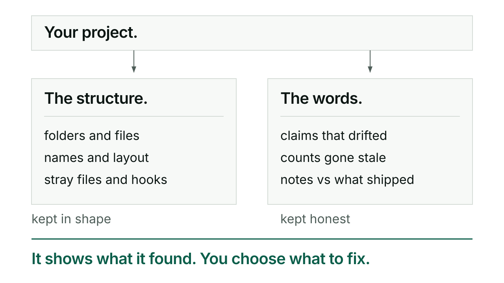

# Tend and Slainte

Tend keeps a repo's structure and plumbing in shape: directories, config files, naming, stray files, the vault, the hooks. Slainte keeps the content honest: whether a doc's claims still match the code, whether a count is stale, whether the release notes describe what actually shipped.

## When you would reach for it

Tend is optional: you can start with `/kerd:switch in` and never run it. Reach for it on a project not yet set up for Kerd, when you want the folders and files Kerd uses created for you, or on one already set up, after a Kerd update, to catch what has drifted from current convention. Reach for slainte when you want to know if the words in a doc still match the state of the project, on demand for one area, or at a release: after a version bump, run slainte's release pass yourself; nothing calls it for you.

## How tend goes

```
/kerd:tend
```

Run it at the root of a git repo. Which report you get depends on the project.

A project **not yet set up for Kerd** gets a plain-words report: what tend would add or change and why (for example the `kivna/` and `kivna/sessions/` folders and a few `.gitignore` lines), with optional files such as `CLAUDE.md` or `docs/playbook.md` listed as optional, never as failures. A project **already set up** (it has a `kivna/vault.json`, a `docs/playbook.md` or anything in `kivna/` other than `sessions/` and `.gitkeep`; a project with only Switch's session logs still gets the plain report) gets the drift report: nine categories (directory structure, required files, vault integration, deprecated patterns, naming consistency, stray and stale files, gitignore hygiene, skill hygiene, and hook hygiene), each passing, failing, or a warning. Failing and warning items get a table of what is there now against what is proposed, with a reason. A failing line is a gap against Kerd's layout, not a sign that something is wrong with your project.

After the report, you approve: for the drift report, fix everything, pick items one at a time, or skip and just keep the report. Tend changes only what its report lists, and only after you approve. It never commits its own changes. Structural fixes stay in the working tree until you review and commit them yourself.

## How slainte goes

```
/kerd:slainte <area>
```

Valid areas are docs, code, site, deps, playbook, release, and all. Each finding gets a severity, high, medium, or low, and evidence: the specific command or comparison that found it, never a bare claim. The release pass is the one exception to report-only: you run it with `/kerd:slainte release` after a version bump, and it fixes what is drift under your verification gate, then lists what it deliberately left untouched and why.

## An exchange

The drift report, for a project already set up, reads like this, a passing category shown plain and a failing one shown as a table:

```
✓ Directory structure
  kivna/  kivna/sessions/  docs/

✗ Vault integration
  ┌──────────────────┬───────────────┬─────────────────────────────┐
  │ Item             │ Current       │ Proposed                    │
  ├──────────────────┼───────────────┼─────────────────────────────┤
  │ symlinks         │ 8 found       │ remove all (vault spec      │
  │                  │               │ prohibits repo symlinks)    │
  └──────────────────┴───────────────┴─────────────────────────────┘
```

Then, outside the table, the decision: the report is the problem and the facts, the options are
fix all, pick individually or skip, and Tend gives its recommendation (usually fix all) with
why, the cost, what the fix would overwrite, and who else checked it. Then:

> 💬 **Fix all three findings — approve?**

Slainte's findings carry the same discipline about evidence. A real line from its own format: `medium | CLAUDE.md § Tests | Test count says 145, actual is 148 | find . -name "*.test.*" | wc -l → 148; CLAUDE.md line 67 says 145`.

## What tend and slainte will not do

Tend never touches content, only structure: it will tell you a file is missing, never rewrite what a doc says. Slainte is the reverse, it audits what the words claim, never the directory layout. Neither of them commits on your behalf outside the release pass's own verification gate. And slainte's on-demand area audits report only by default, they do not fix anything unless you ask.

## For the curious

Tend delegates vault setup to `/kerd:kivna scaffold` rather than reimplementing it, and once all its fixes are applied and nothing has changed since, running it again changes nothing. Slainte's release pass leaves the mechanical checks, version sync, capability-list sync, namespace prefixes, to CI, and owns only the judgment layer CI cannot: skill-count claims, cross-doc claim verification, marketplace URL, hook currency. Full command reference: [reference](reference.md).


