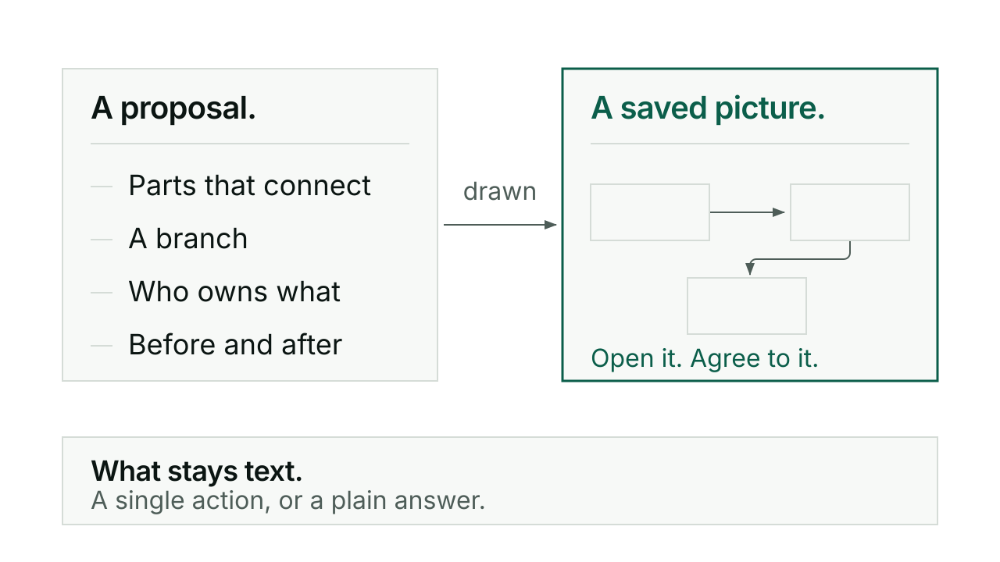

# Visuals

Visuals draws the thing you are discussing: how the parts connect, who owns what,
where the boundary of the work sits, what changes between before and after. It
produces a saved, rendered picture you can open, not a diagram made of text boxes
in a code fence.

## When you would reach for it

You rarely have to reach for it. Since v0.132.0 a picture arrives by default
whenever a proposal carries two or more connected parts, a branch, an ownership
boundary, or a before and after change. There is no offer question asking whether
you would like a diagram, and no quota. Only a single action or a factual answer
stays as text.

You would ask for one directly when you want to see something specific: the shape
of a plan before you agree to it, who is connected to the result, what is inside
the scope and what is outside, or the path a decision takes.

```
/kerd:visuals
```

Being easy to describe in words is not a reason to skip the picture. That is the
rule the skill holds itself to.

## How it goes

The picture starts from a question, not a diagram type. You are never asked to
pick between a flowchart and a sequence diagram; the work names the question the
picture has to answer, and the pattern follows from that.

It is drawn at product level first: people, capabilities, work and outcomes.
Technical architecture is a deeper view for when it helps, not the default
vocabulary. Symbols, file names, line numbers and type names sit in a subordinate
layer, never in the main relationship.

What comes back is one self-contained HTML file with the drawing inside it, saved
beside the work, plus a short line saying what it clarifies. Where the view can be
rendered and opened here, it is rendered, looked at, and checked at desktop width,
where you read it; a phone check, when it matters, never reshapes a themed sheet.
It is drawn in your look: a theme you asked for on that one diagram, otherwise
the profile your project names, otherwise the style diagram-design is set to on
your machine, never a palette picked for the occasion.
Where it cannot be rendered, you are told that plainly instead of being told it
looks fine.

Parts that are proposed, partial or unknown are labelled as such. The view does
not quietly complete itself by guessing a requirement you never gave it.

Underneath, every Kerd view goes through one of two tools: diagram-design for
static layouts such as processes, timelines, responsibilities, scope and
comparisons, or Archify where exploration or comparing changes earns it. Those are
tendencies rather than a hard split, and a piece of work can use both. The starter
patterns bundled with the skill help choose the view; they do not draw it. The
project, product or repository leads the render's top heading, in capitals with a colon
(`KERD: Invoice export · proposal from notes.md · not built`), because a
filename, a browser tab and the surrounding message all sit outside the picture,
and the picture travels without them. Each state looks different in more than one way: what exists
today in a solid outline, what is proposed dashed, and the change the view is about on plain
paper with a solid, heavier accent border.

## A short exchange

The test every view has to pass is worth quoting, because it explains why the
pictures look the way they do. From the skill:

> remove every code reference, and the main relationship must still be
> understandable to a reader who has not opened the source.

A view that recommends or depicts a change carries more. Stripped of its code
references it must still show what you can and cannot do today, where the
responsibility sits, what changes, and any material cost or boundary that exists.
Content decides which test applies, not the title. If removing the code references
leaves the picture unreadable, it was drawn at the wrong level and gets drawn
again.

So a proposal in a Conductor session does not come back as a wall of prose with an
offer to draw something if you want it. It comes back as the summary, the saved
view, and one question about the actual decision.

## A different look: the Intersect theme

Diagrams normally come out in whatever look your diagram-design is set to. Kerd
also ships one opt-in theme, Intersect: a photocopied engineering schematic in
white, toner black and one red, all in capitals, with numbered pin tags,
chevron banners and studded flow lines. Ask for it in plain words:

- "Draw this in the intersect theme" changes that one diagram; no profile or setting changes.
- "Switch to intersect theme" (or "use the intersect diagram theme") changes the
  project you are in. Kerd saves the theme as a diagram-design profile and asks
  before adding a one-line `.diagram-design` file to your repository.
- "Make intersect my default" changes every project on your machine that has not
  chosen its own look; a project with its own `.diagram-design` file keeps it.
  Kerd first says which look you have now and offers to save it if it is not
  saved yet. A diagram-design update puts its own default back.

Switching back works the same way, at the same scope, and puts back the look you
had, never a guess. Archify never reads your look, so once you have chosen one (a
project's, or a theme you made your default, such as Intersect) Kerd draws with
diagram-design; an Archify view comes only when you ask for one or its
exploration is the point, and Kerd says it is in Archify's own look.

## What it will not do

It will not hand you ASCII art in a code fence and call that a diagram. If neither
required tool can run on your machine, it says the view is not rendered and what
that costs you, rather than substituting something hand drawn.

It will not install a tool behind your back. The two tools are required, and
installing a missing one is still asked for; approval to draw a diagram is not
approval to install software.

It will not turn a picture into an approval gate. There is no seal, no fingerprint
and no "approve this diagram" step. Your actual agreement lives in the work record,
and when agreement is needed the question names the outcome, the boundaries and the
real tradeoffs.

It will not stop to ask you about colours, layout, type or export format. Those are
resolved from the work. A genuine product decision the drawing exposes gets asked
as that decision.

And it will not claim you saw something you did not. If preview is unavailable, it
says so and asks you to open the file, rather than recording an approval of a view
nobody looked at.

## For the curious

Visuals is a light Kerd adaptation of Cathryn Lavery's diagram-design. No CI,
hooks, seals, branding onboarding or diagram approval schema is required to use
it.

The default output is one HTML file with inline SVG and CSS and system fonts,
static first, saved with the work. Interaction is added only where it explains
something. Related views in the same piece of work share a visual style, and
known project branding is used when it is available without a separate setup
conversation.

Layout rules are the ordinary ones: simple horizontal and vertical connections
with clear endpoints, routing around unrelated nodes, no collisions between lines
and labels, no meaning carried by colour alone, and text never shrunk until it is
unreadable. A theme that draws a full-size sheet, like Intersect, stays full size
and scrolls sideways on a narrow screen; otherwise a wide diagram may be split
into readable parts.

[Conductor](conductor.md) loads this skill when it draws, which is most of why
you see views during rehearsal rather than only at the end.

Every command in one line each: [reference](reference.md).


